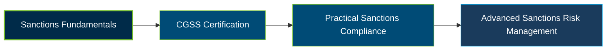

# ACAMS CGSS Certification Exam Guide

A dedicated, comprehensive study guide and sanctions compliance reference repository for candidates preparing for the **ACAMS Certified Global Sanctions Specialist (CGSS) Certification Exam**.

---

## Exam Overview

The ACAMS CGSS Certification validates specialist knowledge of global sanctions frameworks, sanctions compliance programs, screening controls, and methods used to detect and investigate sanctions evasion.

- **Exam Format**: Computer-based examination with multiple-choice and multiple-select questions.
- **Target Audience**: Sanctions Compliance Officers, AML/CTF Professionals, Financial Crime Investigators, Legal and Regulatory Specialists, and Global Trade Compliance Professionals.
- **Prerequisites**: Active ACAMS membership and 40 eligibility credits based on qualifying education, professional experience, certifications, and training.

---

## Core Exam Domains & Knowledge Areas

### 1. Sanctions Frameworks and Governance

- Understand the purpose of sanctions, the authorities that impose them, and applicable international and domestic frameworks.
- Identify sanctions restrictions, permissible activities, and the consequences of non-compliance.
- Understand sanctions risk exposure across financial institutions, global trade, and cross-border transactions.

### 2. Building a Sanctions Compliance Program

- Conduct sanctions risk assessments and establish risk-based policies, procedures, and internal controls.
- Apply sanctions due diligence, beneficial ownership analysis, and customer and third-party screening.
- Understand screening systems, payment filtering, sanctions technology, data quality, and control effectiveness.

### 3. Detecting and Investigating Sanctions Evasion Techniques

- Recognize evasion through payments, trade transactions, concealed ownership, and intermediary entities.
- Investigate suspicious activity using internal records, external sources, and supporting evidence.
- Understand asset freezing, frozen-asset management, reporting obligations, and tipping-off considerations.

### 4. Sanctions Compliance Case Studies

- Apply sanctions frameworks and risk assessment principles to practical compliance scenarios.
- Evaluate screening alerts, investigate potential sanctions breaches, and determine appropriate escalation.
- Use case-based exercises to reinforce decision-making, documentation, and compliance controls.

---

## Certification Path

The following diagram illustrates a suggested learning progression, not an official ACAMS prerequisite or successor-certification pathway.

---

## Recommended Practice & Study Resources

To prepare effectively, combine official ACAMS learning materials with supplementary practice and practical sanctions compliance exercises.

- **CertsGate**: Explore [CGSS certification preparation resources](https://certsgate.com/exams/acams/cgss) for supplementary study materials and practice questions to reinforce sanctions frameworks, screening controls, and evasion investigation concepts.
- **Practical Study Resource**: Consult the [OFAC Sanctions Programs and Country Information](https://ofac.treasury.gov/sanctions-programs-and-country-information) and apply sanctions requirements to hypothetical screening, ownership, payment, and trade-compliance scenarios.
